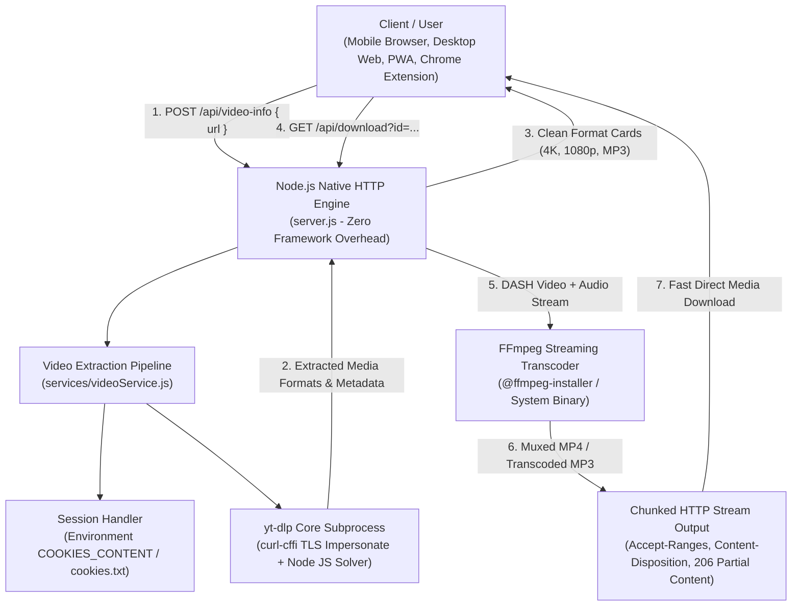

<div align="center">

# ⚡ Social Downloader

### *The Universal, High-Performance Social Media Downloader & Media Extraction Suite*

[](LICENSE)
[](https://nodejs.org/)
[](https://www.python.org/)
[](https://github.com/yt-dlp/yt-dlp)
[](https://ffmpeg.org/)
[](Dockerfile)
[](chrome-extension/)

<p align="center">
  <b>Extract and download Ultra HD 4K, 1080p 60fps MP4 videos, 320kbps MP3 audio, reels, shorts, stories, carousels, and high-res thumbnails across 50+ platforms with zero registration, zero ads bloat, and lightning-fast speeds.</b>
</p>

[✨ Live Demo](#-live-deployment) • [🚀 Quick Start](#-quick-start) • [🧩 Chrome Extension](#-chrome-extension-manifest-v3) • [📡 API Reference](#-api-documentation) • [🐳 Docker Deploy](#-docker--cloud-deployment)

---

</div>

## 🌟 Highlights

- 🎬 **True 1080p & 4K Video Muxing**: Automatically merges separated video (DASH) and high-quality audio streams on the fly using embedded FFmpeg with zero audio desync.
- 🎵 **Lossless 320kbps MP3 Converter**: Instant high-bitrate MP3 audio extraction from any music video, lecture, podcast, or social clip.
- 📱 **Mobile-First Responsive Design**: Tailored for Android, iOS, tablets, and desktops with a sticky dual-row header, touch-friendly horizontal pill scrolling, and fluid typography.
- ⚡ **Zero-Latency In-Memory Stream Piping**: Downloads are streamed directly into HTTP response pipes—saving massive disk space with automated temporary file auto-cleanup.
- 🧩 **Manifest V3 Chrome Extension**: Includes an auto-detecting popup, right-click context menu downloader, batch page media grabber, and floating site overlay buttons.
- 🌐 **50+ Dedicated Platform Landing Pages**: Full SEO and GEO schema markup (FAQ, BreadcrumbList, SoftwareApplication) covering TikTok, Instagram, YouTube, Facebook, X (Twitter), Pinterest, Reddit, Threads, and dozens more.
- 🔒 **Cookie Session Manager**: Supports Netscape `cookies.txt` or the `COOKIES_CONTENT` environment variable for seamless age-restricted and private media handling without committing credentials.
- 📲 **Progressive Web App (PWA)**: Complete offline caching, Service Worker (`sw.js`), custom installation banners, and web app manifest support.

---

## 🛠️ Supported Platforms

| Platform | Supported Formats | Features |
| :--- | :--- | :--- |
| **YouTube** | 4K, 1440p, 1080p 60fps, 720p, 360p, MP3 | Shorts, Full Videos, Chapters, Thumbnails |
| **TikTok** | HD MP4, MP3, Cover Art | No Watermark, Photo Slides, Profile Clips |
| **Instagram** | 1080p MP4, Full HD Photos, Audio | Reels, Stories, Carousels, IGTV |
| **Facebook** | 1080p, 720p, SD, MP3 | Public Reels, Watch Videos, Shared Feeds |
| **X (Twitter)** | 1080p, 720p, 480p, MP4, GIF | Video Tweets, Audio Spaces Recordings |
| **Pinterest** | 1080p, 720p MP4, Original JPG | Pins, Story Pins, Idea Pins |
| **Reddit** | HD MP4 (with audio muxing) | Reddit Video (v.redd.it) with clean sound |
| **Threads** | Original Quality MP4 & JPG | Videos, Carousel Photo Slides |
| **Vimeo** | 4K, 1080p, 720p, Adaptive Streams | Original Source & Transcoded MP4 |
| **SoundCloud** | 320kbps MP3 & M4A | Tracks, Sets, Artwork |
| **50+ Others** | Dailymotion, Rumble, Bilibili, TeraBox, Kwai, etc. | Comprehensive Universal Parser |

---

## 🏗️ System Architecture



---

## 📁 Repository Structure

```
social-downloader/
├── 📂 chrome-extension/       # Complete Manifest V3 Browser Extension
│   ├── manifest.json         # Extension configuration & host permissions
│   ├── popup.html / popup.js # User interface with format selector & history
│   ├── background.js         # Service worker handling downloads & context menus
│   ├── content.js            # Injects floating download triggers onto video sites
│   ├── styles.css            # Extension glassmorphism UI styling
│   └── 📂 admin/             # Extension analytics & custom API switcher
├── 📂 public/                 # Production Frontend Assets & PWA
│   ├── index.html            # Core application layout & dynamic template
│   ├── styles.css            # Mobile-first CSS system with dark & light themes
│   ├── app.js                # Frontend client controller & fetch engine
│   ├── platforms.js          # Metadata & routes for 50+ SEO landing pages
│   ├── blogs.js              # Comprehensive tech guides & downloader articles
│   ├── manifest.json         # PWA installation manifest
│   └── sw.js                 # Service Worker with offline asset caching
├── 📂 services/               # Core Backend Services
│   ├── videoService.js       # yt-dlp wrapper, format resolver & token encryption
│   └── localFfmpegPath.js    # Multi-platform FFmpeg/FFprobe binary resolver
├── 📂 scripts/                # Build & Tooling Scripts
│   └── build-static.js       # Pre-renders 50+ SEO static HTML pages into dist/
├── server.js                 # High-performance native Node.js HTTP server
├── package.json              # Dependencies, npm scripts & metadata
├── Dockerfile                # Production Docker container definition
├── .gitignore                # Comprehensive ignore rules (secures cookies.txt)
└── README.md                 # Project documentation
```

---

## 🚀 Quick Start

### Prerequisites

- **Node.js**: `v18.0.0` or higher ([Download](https://nodejs.org/))
- **Python**: `v3.10` or higher with `pip` ([Download](https://www.python.org/))
- **Git**

### 1. Clone the Repository

```bash
git clone https://github.com/majidarain778866-ui/social_downloader.git
cd social_downloader
```

### 2. Install Dependencies

```bash
# Install Node.js dependencies (including local FFmpeg)
npm install

# Install yt-dlp with curl-cffi for TLS browser impersonation
python -m pip install -U "yt-dlp[default,curl-cffi]"
```

### 3. Run Locally

```bash
# Start the local development server
npm start
```

Your server will be running live at:
👉 **`http://localhost:3000`**

---

## ⚙️ Environment Variables

Configure these in your hosting dashboard or local `.env` file:

| Variable | Default | Description |
| :--- | :--- | :--- |
| `PORT` | `3000` | Port for the HTTP server (set to `7860` on Hugging Face Spaces). |
| `SITE_URL` | `http://localhost:3000` | Canonical production domain URL (e.g. `https://socialdownloader.app`). |
| `COOKIES_CONTENT` | *(Optional)* | Netscape format cookie string for accessing private/member videos. |
| `YTDLP_COOKIES` | *(Optional)* | Alias for `COOKIES_CONTENT`. |
| `NODE_ENV` | `development` | Environment mode (`production` or `development`). |
| `PYTHON` | `python` / `python3` | Explicit path to the Python binary. |

---

## 🧩 Chrome Extension (Manifest V3)

The project includes an enterprise-ready Chrome/Edge/Brave extension located in the `chrome-extension/` directory.

### Features
- **Auto-Detect**: Instantly identifies the video playing in your active tab.
- **Floating Overlays**: Injects discrete "Download HD" buttons directly into YouTube, TikTok, and Instagram video players.
- **Right-Click Context Menu**: Download media simply by right-clicking any video, link, or image.
- **Batch Media Grabber**: Scans any web page and extracts all downloadable assets in one list.
- **6 Accent Themes**: Customize your popup look (Violet, Cyan, Pink, Emerald, Amber, Blue).

### Installation in Developer Mode
1. Open your browser and navigate to `chrome://extensions/`.
2. Toggle on **Developer mode** in the top right corner.
3. Click **Load unpacked**.
4. Select the `chrome-extension` folder inside this repository.
5. Pin the extension and start downloading!

---

## 📡 API Documentation

### 1. Fetch Media Details

Analyze any social media URL and receive parsed formats, resolutions, creator info, and direct download links.

- **Endpoint**: `POST /api/video-info`
- **Headers**: `Content-Type: application/json`
- **Request Body**:
```json
{
  "url": "https://www.youtube.com/watch?v=dQw4w9WgXcQ"
}
```

- **Response (200 OK)**:
```json
{
  "title": "Rick Astley - Never Gonna Give You Up",
  "platform": "YouTube",
  "duration": "3:33",
  "thumbnail": "https://i.ytimg.com/vi/dQw4w9WgXcQ/maxresdefault.jpg",
  "author": "Rick Astley",
  "downloads": [
    {
      "label": "1080p Full HD MP4 Video",
      "resolution": "1080p",
      "type": "video",
      "extension": "mp4",
      "download_url": "/api/download?id=KcZ6PluypMC3A..."
    },
    {
      "label": "MP3 High Quality Audio (320kbps)",
      "resolution": "320kbps",
      "type": "audio",
      "extension": "mp3",
      "download_url": "/api/download?id=7JTEnZfpOg..."
    }
  ]
}
```

### 2. Stream Media Download

- **Endpoint**: `GET /api/download?id=<token>`
- **Query Parameters**:
  - `id`: Encrypted token generated from `/api/video-info`
  - `preview=1` *(Optional)*: Streams media with `inline` Content-Disposition for in-browser playback.

---

## 🐳 Docker & Cloud Deployment

### Run with Docker

The project includes an optimized multi-stage `Dockerfile` running on `node:20-bookworm-slim` with Python virtual environments and system FFmpeg pre-configured:

```bash
# Build the Docker image
docker build -t social-downloader .

# Run the container on port 7860
docker run -p 7860:7860 -e PORT=7860 social-downloader
```

### One-Click Deployments

#### 🚀 Render.com
1. Connect your GitHub repository.
2. Select **Web Service**.
3. **Environment**: `Node`
4. **Build Command**: `npm install && python -m pip install -U "yt-dlp[default,curl-cffi]"`
5. **Start Command**: `node server.js`

#### 🚂 Railway.app
1. Click **New Project** -> **Deploy from GitHub repo**.
2. Railway will automatically detect the `Dockerfile` and deploy seamlessly.

#### 🤗 Hugging Face Spaces
1. Create a new Space with the **Docker** SDK.
2. Push this repository to your Space remote:
   ```bash
   git push hf main
   ```

---

## 📱 Mobile & PWA Experience

- **Sticky Adaptive Topbar**: Keeps your brand, theme toggle, and platform navigation accessible across all viewport sizes without blocking screen real estate.
- **Touch-Optimized Scrolling**: Seamless horizontal gesture scrolling on platforms list.
- **Offline Capable**: Static resources are cached locally via Service Worker (`/sw.js`).
- **Home Screen Installation**: Native "Install App" prompt for Android (Chrome) and iOS (Safari).

---

## 🤝 Contributing

Contributions, feature suggestions, and bug reports are warmly welcome!
1. Fork the Project.
2. Create your Feature Branch (`git checkout -b feature/AmazingFeature`).
3. Commit your Changes (`git commit -m 'feat: Add some AmazingFeature'`).
4. Push to the Branch (`git push origin feature/AmazingFeature`).
5. Open a Pull Request.

---

## 📄 License

Distributed under the **MIT License**. See [`LICENSE`](LICENSE) for more information.

<div align="center">

Made with ❤️ for creators, developers, and media enthusiasts worldwide.

**[⭐ Star this repository](https://github.com/majidarain778866-ui/social_downloader)** if you found it useful!

</div>
